  <a href="https://www.linkedin.com/in/eduardosantosalm/"><b>LinkedIn ↗</b></a>
  &nbsp;·&nbsp; Java backend developer at <a href="https://www.cassi.com.br">CASSI</a>
  &nbsp;·&nbsp; Brasília, Brazil

🇧🇷 <b>Versão em português</b>

 

Desenvolvedor backend Java com **mais de 4 anos de experiência**, construindo e modernizando sistemas corporativos. Hoje na **[CASSI](https://www.cassi.com.br)**, com Spring Boot, Quarkus e Kafka, migrando sistemas legados para arquiteturas modernas.

Este perfil foi desenhado como um conjunto de pranchas técnicas:

- **Prancha 01 — Arranjo geral:** como eu trabalho. As requisições passam por uma fachada enquanto o legado (Oracle SOA, Apache Camel, ASP.NET MVC, OpenShift 3) é substituído aos poucos por serviços novos orientados a eventos, no padrão *strangler fig*. A nuvem vermelha marca a revisão D, a CASSI.
- **Prancha 02 — Histórico de revisões:** minha carreira. 0: bacharelado na UniProjeção (2021) · A, B e C: júnior, pleno e sênior na CAST group (2022–2024) · D: CASSI (2024) · E: pós-graduação em Engenharia de Software Ágil na UNIASSELVI (2026).
- **Prancha 03 — Lista de materiais:** minha stack. Os itens hachurados (Apache Camel, Oracle SOA, ASP.NET MVC) são o legado que eu migro.

