  Java backend developer from Brasília, Brazil. I like clean APIs, event-driven systems 
  and turning legacy code into something a team enjoys working on.

  
  &nbsp;
  

Styled after Brasília's metro, which runs two lines: green and orange.

🇧🇷 <b>Versão em português</b>

 

Desenvolvedor backend Java em **Brasília**. Gosto de APIs bem feitas, sistemas orientados a eventos e de transformar código legado em algo em que dá gosto trabalhar.

- **Agora:** serviços backend na **[CASSI](https://www.cassi.com.br)**, uma das maiores operadoras de autogestão em saúde do país, com Spring Boot, Quarkus e Apache Kafka no OpenShift.
- **Estudando:** DDD, Clean Architecture e TDD, na pós-graduação em Engenharia de Software Ágil.
- **Antes:** CAST group, onde passei de júnior a sênior em 15 meses.
- **Stack:** Java, Spring Boot, Quarkus, Apache Kafka, REST, SOAP, OpenShift, SQL Server, Oracle, React, C# e ASP.NET MVC.
- **Modernização de legado:** ASP.NET Web Forms → ASP.NET MVC · Apache Camel → Spring Boot · todos os serviços SOAP do Oracle SOA → APIs REST em Spring Boot · ASP.NET MVC 4.6 → Java + React · OpenShift 3 → OpenShift 4.

Portfólio: **[eduardo-alecrim.github.io](https://eduardo-alecrim.github.io)**. Vamos conversar? Me chama no **[LinkedIn](https://www.linkedin.com/in/eduardosantosalm/)**.

