

 

 

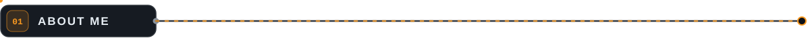

Backend developer with <b>4+ years in Java</b>, building and modernizing enterprise systems. Today I work at <b><a href="https://www.cassi.com.br">CASSI</a></b>, one of Brazil's largest self-managed health plans, building services with <b>Spring Boot</b>, <b>Quarkus</b> and <b>Kafka</b> and moving legacy systems to modern architectures. Before that, at <b>CAST group</b>, I went from junior to senior in just over a year.

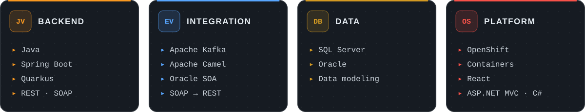

<b>Currently studying</b> 
<code>DDD</code> · <code>Clean Architecture</code> · <code>TDD</code> — postgrad in Agile Software Engineering at UNIASSELVI

 

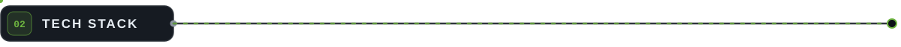

<code>BACKEND &amp; MESSAGING</code> 

<code>PLATFORM &amp; FRONTEND</code> 

 

<code>Quarkus</code> · <code>Apache Camel</code> · <code>SQL Server</code> · <code>Oracle</code> · <code>REST</code> · <code>SOAP</code>

 

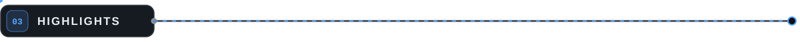

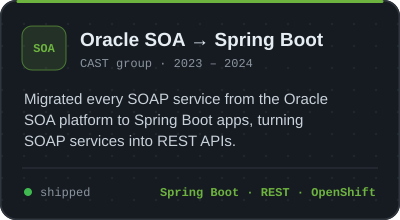
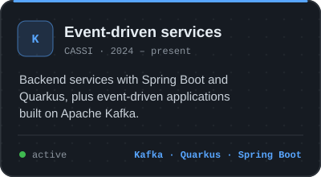
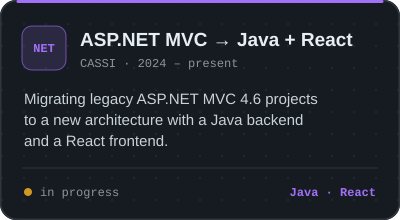

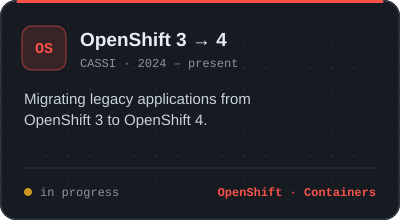
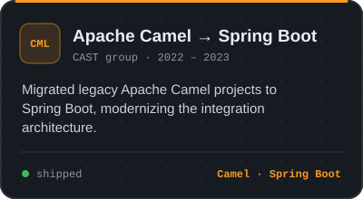
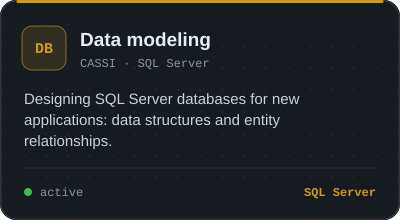

🇧🇷 <b>Versão em português</b>

 

Desenvolvedor backend com **mais de 4 anos em Java**, construindo e modernizando sistemas corporativos. Hoje atuo na **[CASSI](https://www.cassi.com.br)**, uma das maiores operadoras de autogestão em saúde do país, desenvolvendo serviços com **Spring Boot**, **Quarkus** e **Kafka** e migrando sistemas legados para arquiteturas modernas. Antes, na **CAST group**, passei de júnior a sênior em pouco mais de um ano.

**Destaques**

- **Oracle SOA → Spring Boot** (CAST group): migração de todos os serviços SOAP para Spring Boot, convertendo SOAP em APIs REST, com deploy no OpenShift
- **Serviços orientados a eventos** (CASSI): Spring Boot, Quarkus e Kafka
- **ASP.NET MVC → Java + React** (CASSI): nova arquitetura para projetos legados em ASP.NET MVC 4.6
- **OpenShift 3 → 4** (CASSI): migração de aplicações legadas
- **Apache Camel → Spring Boot** (CAST group): modernização da arquitetura de integração
- **Modelagem de dados** (CASSI): bancos SQL Server das novas aplicações

**Estudando:** DDD, Clean Architecture e TDD, na pós-graduação em Engenharia de Software Ágil da UNIASSELVI.

 

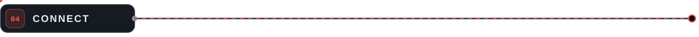

  

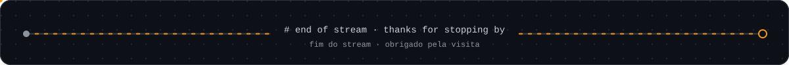

